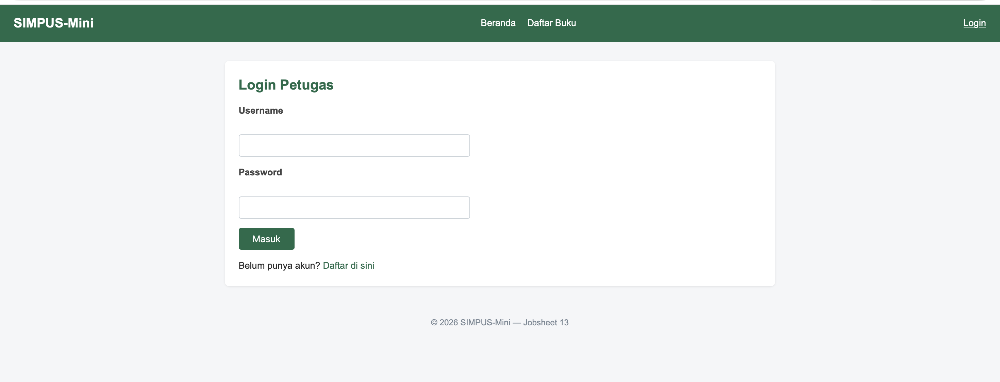
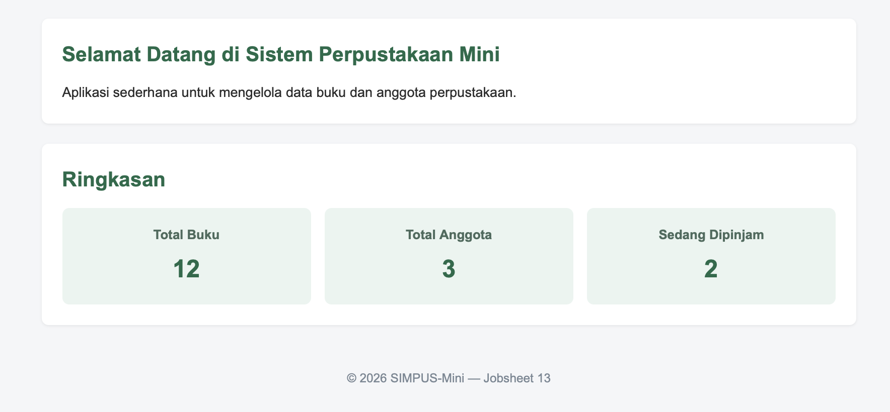
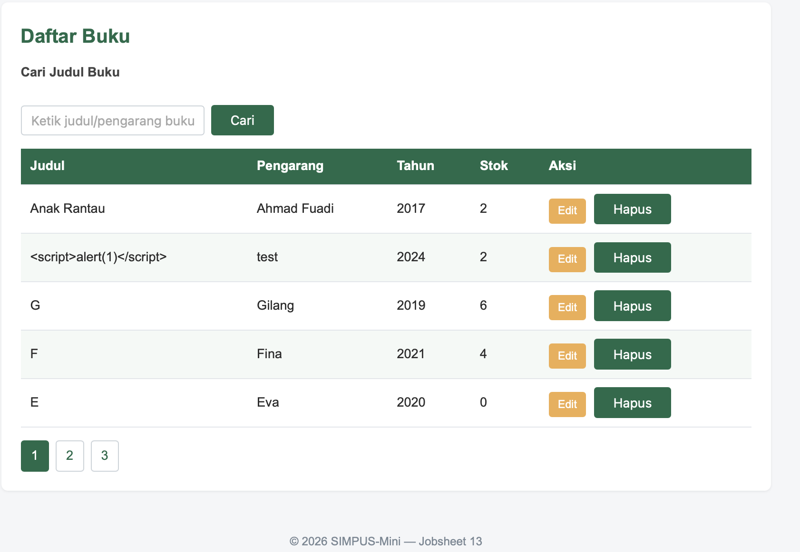
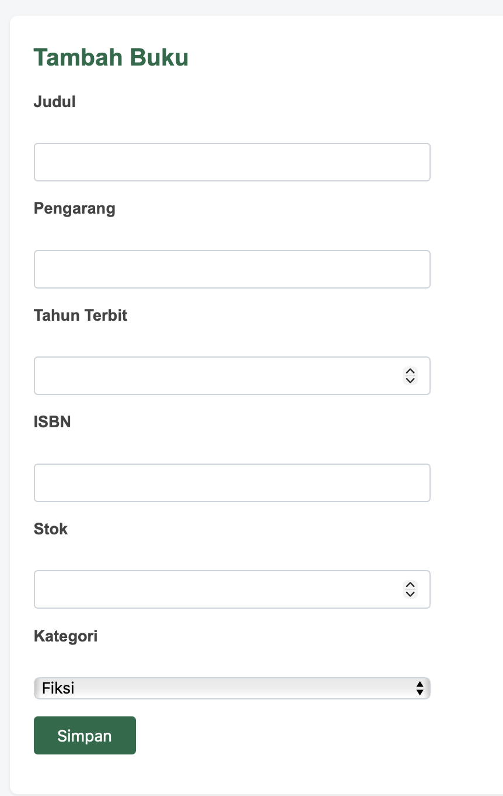
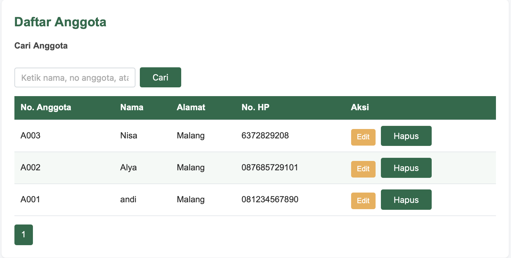
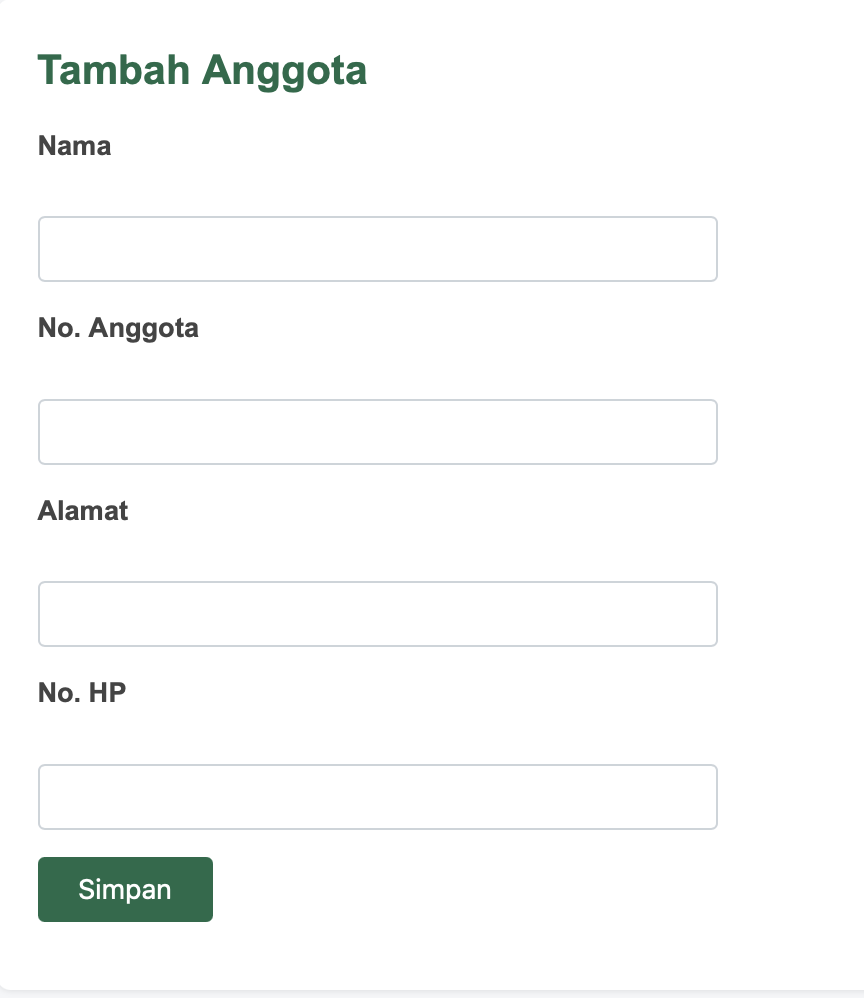
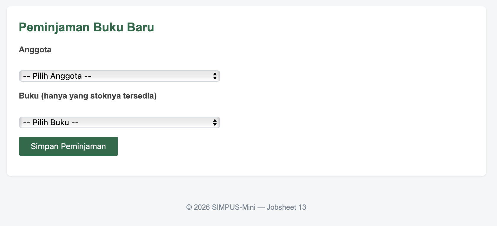
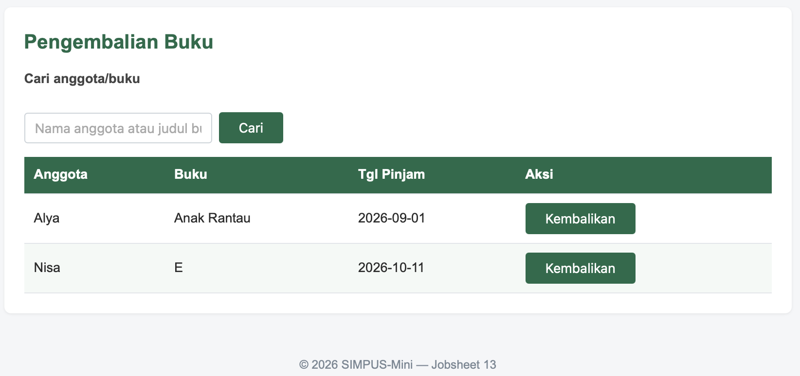
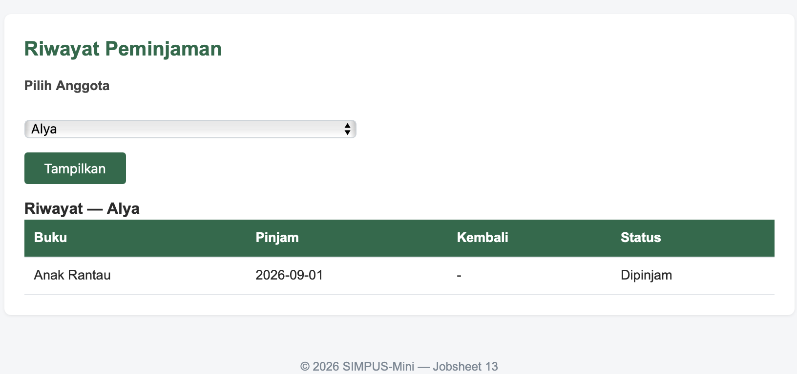

# Panduan Penggunaan SIMPUS-Mini

Dokumen ini berisi panduan langkah demi langkah penggunaan aplikasi SIMPUS-Mini untuk petugas perpustakaan.

---

## 1. Registrasi & Login Petugas

1. Buka halaman utama aplikasi di browser (`http://localhost:8888/PemrogWeb_smt3/Jobsheet_13/`).
2. Klik tombol **Login** di pojok kanan atas menu header.
3. Jika belum memiliki akun, klik tautan **Daftar di sini** pada halaman login.
4. Isi **Nama**, **Username**, dan **Password** (minimal 6 karakter), lalu klik **Daftar**.
5. Setelah registrasi berhasil, masuk menggunakan username dan password yang telah didaftarkan.

---

## 2. Beranda Utama

Setelah berhasil login, petugas akan diarahkan ke halaman **Beranda** yang menampilkan ringkasan statistik total buku, total anggota, dan jumlah buku yang sedang dipinjam.

---

## 3. Kelola Data Buku

1. **Melihat Daftar Buku**: Klik menu **Daftar Buku** untuk melihat seluruh koleksi buku beserta jumlah stok tersisa. Gunakan kolom pencarian untuk memfilter judul buku.
   
   

2. **Menambah Buku Baru**: Klik menu **Tambah Buku**, isi data judul, pengarang, tahun terbit, ISBN, stok, dan kategori, lalu klik **Simpan**.

   

3. **Mengubah Data Buku**: Pada tabel daftar buku, klik tombol **Edit** pada baris buku yang ingin diperbarui, ubah data lalu klik **Update**.

4. **Menghapus Buku**: Klik tombol **Hapus** pada baris buku yang bersangkutan, lalu konfirmasi dialog peringatan.

---

## 4. Kelola Data Anggota

1. **Melihat Daftar Anggota**: Klik menu **Daftar Anggota** untuk melihat daftar anggota perpustakaan yang terdaftar.

   

2. **Menambah Anggota Baru**: Klik menu **Tambah Anggota**, isi nama, nomor anggota, alamat, dan nomor HP, lalu klik **Simpan**.

   

3. **Mengubah/Menghapus Anggota**: Gunakan tombol **Edit** atau **Hapus** pada baris anggota terkait di tabel daftar anggota.

---

## 5. Transaksi Peminjaman & Pengembalian Buku

1. **Peminjaman Baru**:
   - Klik menu **Peminjaman Baru**.
   - Pilih **Anggota** dan **Buku** yang ingin dipinjam (hanya buku dengan stok > 0 yang akan muncul).
   - Klik **Simpan Peminjaman**. Stok buku akan otomatis berkurang 1.

   

2. **Pengembalian Buku**:
   - Klik menu **Pengembalian**.
   - Cari transaksi berdasarkan nama anggota atau judul buku.
   - Klik tombol **Kembalikan** pada baris transaksi yang bersangkutan. Status transaksi akan berubah dan stok buku otomatis bertambah 1.

   

3. **Melihat Riwayat Peminjaman**:
   - Klik menu **Riwayat**.
   - Pilih anggota yang ingin dilihat riwayatnya, lalu klik **Tampilkan** untuk melihat seluruh riwayat peminjaman beserta status pengembaliannya.

   